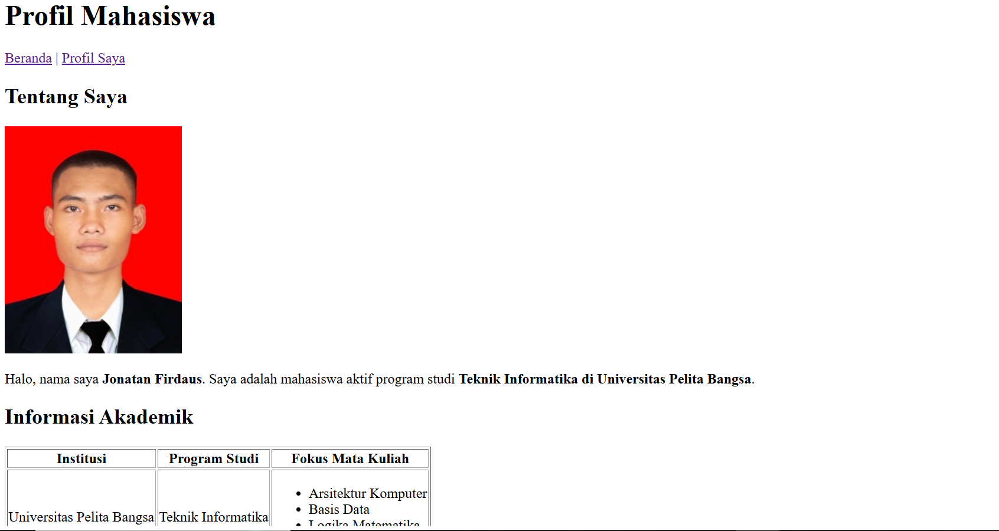
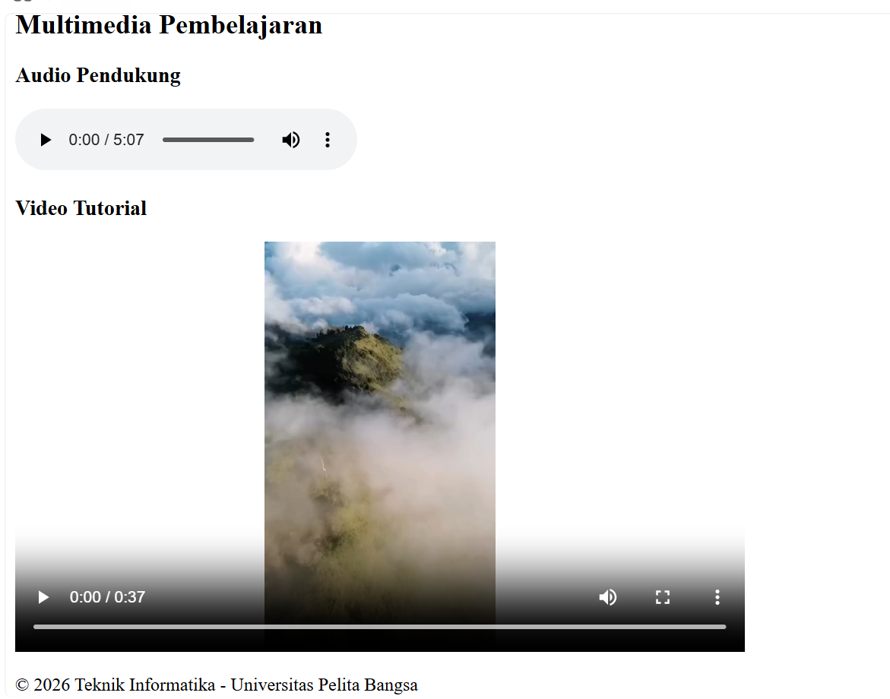

# Lab2Web - Praktikum 2 HTML Lanjutan

Repositori ini berisi hasil pengerjaan **Praktikum 2 Pemrograman Web** mengenai HTML Lanjutan. Pada praktikum ini, saya mempraktikkan pembuatan struktur halaman web yang lebih kompleks menggunakan elemen Semantic HTML, Tabel, Form (beserta validasinya), dan penyisipan Multimedia.

## 📂 Struktur Direktori

```text
Lab2Web/
├── multimedia/
│   ├── eine kleine.mp3
│   ├── mei m nya apa.mp4
│   ├── natan merah.jpeg
│   └── listlist.PNG
├── index.html       (Halaman Utama & Proyek Mini)
├── profil.html      (Halaman Profil Tambahan)
└── README.md
```

## 📝 Langkah-Langkah Praktikum

Berikut adalah rincian tahapan pengerjaan yang telah dilakukan sesuai dengan modul:

### 1. Membuat dan Mengembangkan Tabel Data
*   Membuat struktur tabel HTML dasar menggunakan tag `<table>`, `<tr>`, `<th>`, dan `<td>`.
*   Mengembangkan tabel dengan menambahkan struktur semantik tabel yaitu `<thead>`, `<tbody>`, dan `<tfoot>`.
*   Menggunakan atribut `colspan` untuk menggabungkan sel pada bagian footer tabel.

### 2. Membuat Form Registrasi dan Biodata
*   Membangun form menggunakan tag `<form>` dengan atribut `method="POST"`.
*   Menerapkan berbagai jenis input, meliputi:
    *   Input teks standar (`type="text"`, `type="email"`, `type="password"`).
    *   Input angka dan tanggal (`type="number"`, `type="date"`).
    *   Pilihan tunggal dan ganda menggunakan **Radio Button** dan **Checkbox**.
    *   Menu *dropdown* menggunakan `<select>` dan `<option>`.
    *   Area teks panjang menggunakan `<textarea>`.
*   Menghubungkan label teks dengan kolom input menggunakan atribut `for` pada `<label>` dan `id` pada `<input>`.

### 3. Menerapkan Validasi Form Dasar
*   Menggunakan atribut bawaan HTML5 untuk memvalidasi form di sisi *client* (browser) sebelum dikirim.
*   Menerapkan atribut `required` agar kolom wajib diisi.
*   Menerapkan atribut batas seperti `minlength` untuk panjang karakter, serta `min` dan `max` untuk batas angka (umur).

### 4. Membuat Halaman dengan Semantic HTML
*   Menyusun kerangka *layout* dokumen menggunakan elemen-elemen semantik agar memiliki struktur dan makna yang jelas.
*   Menggunakan elemen `<header>`, `<nav>`, `<main>`, `<section>`, `<article>`, `<aside>`, dan `<footer>`.

### 5. Menambahkan Multimedia
*   Menyisipkan file suara menggunakan tag `<audio>` dan file video menggunakan tag `<video>`.
*   Menambahkan atribut `controls` agar *browser* menampilkan antarmuka pemutar media bawaan (tombol *play*, *pause*, dll).
*   Menyesuaikan ukuran penampil video menggunakan atribut `width` dan `height`.

### 6. Proyek Mini: Halaman Biodata Mahasiswa
*   Menggabungkan seluruh materi di atas ke dalam halaman utama (`index.html`). Halaman ini berisi form pengisian biodata, tabel ringkasan nilai, dan elemen multimedia pendukung yang semuanya dibungkus dalam struktur *Semantic HTML*.
*   Membuat halaman tambahan terpisah (`profil.html`) untuk menampilkan portofolio dan latar belakang akademik secara lebih detail.

### 7. Menjawab pertanyaan seputar modul praktikum
1. Apa fungsi (`table`), (`tr`), (`th`), dan (`td`)?
   - (`table`): Untuk mendefinisikan pembuatan tabel.
   - (`tr`)    : (Table Row) Untuk membuat baris baru di dalam tabel.
   - (`th`)   : (Table Header) Untuk membuat sel judul/header tabel. Teks di dalamnya otomatis ditebalkan (bold) dan rata tengah.
   - (`td`)   : (Table Data) Untuk membuat sel data biasa di dalam baris tabel.

2. Apa perbedaan (`th`) dan (`td`)?
   - (`th`) digunakan khusus untuk baris/kolom judul sehingga tampilannya tebal dan rata tengah.
   - (`td`) digunakan untuk isi data biasa dengan tampilan teks normal dan rata kiri.

3. Apa fungsi colspan pada tabel?
   - `colspan` (column span) digunakan untuk menggabungkan dua atau lebih kolom (sel secara horizontal) menjadi satu sel yang memanjang.

4. Apa fungsi (`form`) dalam HTML?
   - Berfungsi sebagai wadah (container) untuk menampung elemen-elemen input (seperti teks, pilihan, tombol) yang digunakan untuk mengumpulkan data dari pengguna agar bisa dikirim ke server.

5. Apa perbedaan radio button dan checkbox?
   - Radio button (`input type="radio"`) : Pengguna hanya bisa memilih SATU opsi dari kelompok pilihan yang ada (contoh: jenis kelamin).
   - Checkbox (`input type="checkbox"`)  : Pengguna bisa memilih SATU, LEBIH DARI SATU, atau TIDAK SAMA SEKALI dari opsi yang disediakan (contoh: hobi/keahlian).

6. Mengapa (`label`) sebaiknya terhubung dengan id input melalui atribut for?
   - Agar area klik menjadi lebih luas. Ketika teks label diklik oleh pengguna, fokus kursor akan otomatis berpindah ke kolom input tersebut (atau mencentang kotak pilihan). Ini sangat penting untuk aksesibilitas dan kemudahan penggunaan.

7. Apa perbedaan (`textarea`) dengan input type text?
   - (`input type="text`) : Untuk input teks tunggal/satu baris (contoh: nama).
   - (`textarea`)          : Untuk input teks multi-baris yang panjang (contoh: alamat lengkap atau pesan).

8. Apa fungsi semantic HTML seperti (`header`), (`nav`), (`main`), (`section`), (`article`), (`aside`), dan (`footer`)?
   - Fungsinya adalah untuk memberikan struktur dan makna (semantic) yang jelas pada bagian-bagian halaman web, bukan sekadar memisahkan blok. Ini sangat membantu mesin pencari (SEO) dan screen reader untuk memahami bagian mana yang merupakan kepala, navigasi, isi utama, konten sampingan, dan kaki halaman.

9. Apa fungsi required, min, max, dan minlength?
   - Merupakan atribut validasi form di HTML:
     * required  : Mewajibkan pengguna untuk mengisi kolom tersebut sebelum dikirim.
     * min       : Menentukan batas nilai minimal yang diizinkan (untuk angka/tanggal).
     * max       : Menentukan batas nilai maksimal yang diizinkan (untuk angka/tanggal).
     * minlength : Menentukan jumlah karakter minimal yang harus diketikkan oleh pengguna.

10. Apa perbedaan elemen (`audio`) dan (`video`)?
    - (`audio`)  : Khusus untuk menyematkan dan memutar file suara/musik tanpa tampilan visual.
    - (`video`) : Untuk menyematkan file media gambar bergerak (yang biasanya disertai suara). Elemen ini mendukung penyesuaian dimensi visual seperti width (lebar) dan height (tinggi).
-->
---

## 📸 Dokumentasi (Screenshot Hasil Praktikum)

*(Berikut adalah hasil tangkapan layar dari halaman web yang telah dibuat)*

**1. Tampilan Bagian Atas (Tabel & Navigasi)**

*Keterangan: Tampilan tabel data mahasiswa yang sudah menggunakan thead, tbody, dan tfoot.*

**2. Tampilan Form Registrasi (Validasi HTML)**

*Keterangan: Form input dengan berbagai tipe dan implementasi validasi dasar bawaan browser.*

**3. Tampilan Halaman Profil**

*Keterangan: Halaman profil mandiri yang merangkum data diri dan portofolio menggunakan semantic HTML.*

**4. Tampilan Halaman multimedia*

*Keterangan: Halaman berisikan media audio dan video.*

*(Catatan: Pastikan nama file gambar di dalam folder `images` benar-benar sama persis dengan nama file yang ditulis pada bagian kurung di atas, perhatikan huruf besar dan kecilnya).*